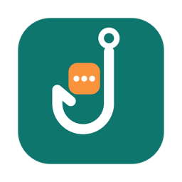
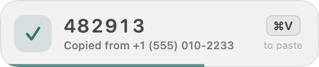
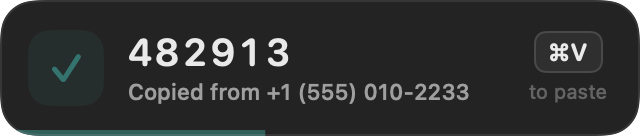
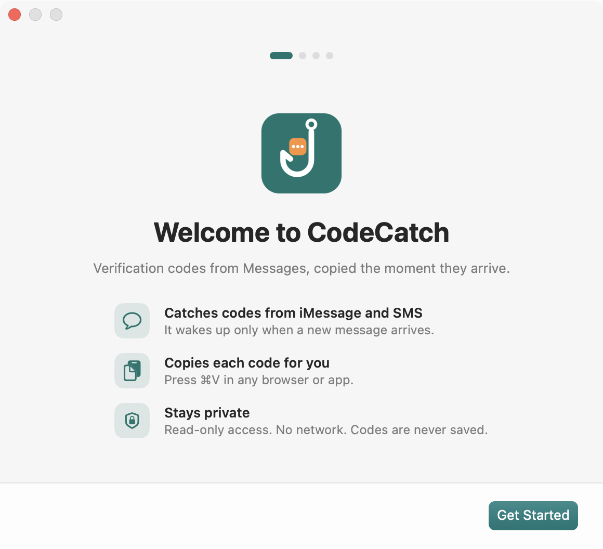
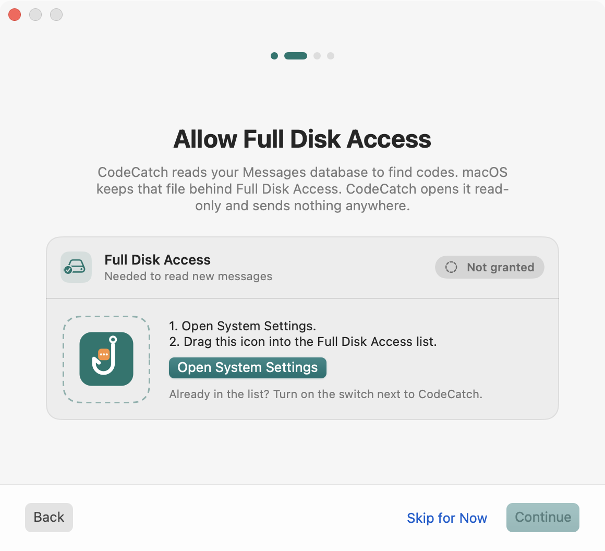
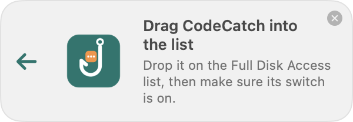

<p align="center">
  
</p>

<h1 align="center">CodeCatch</h1>

<p align="center">
  <a href="https://github.com/Nsilswal/CodeCatch/actions/workflows/ci.yml"></a>
  <a href="LICENSE"></a>
  
</p>

A small macOS menu bar app. It watches incoming iMessages and SMS for verification (MFA / 2FA / OTP) codes. It copies each code to your clipboard right away, so you can press **⌘V** in any browser or app.

- **Native and light.** Pure Swift, AppKit, and SwiftUI. The app is under 500 KB. It has no dependencies, no network access, and no Dock icon.
- **Event driven.** It wakes up only when the Messages folder changes (FSEvents). A 15-second fallback timer covers missed events.
- **Private.** It opens the Messages database read-only. Codes stay in memory only. Nothing goes to disk or to the network. Copied codes carry the `org.nspasteboard.ConcealedType` marker, so clipboard history apps skip them.
- **Works everywhere.** Safari can already autofill codes from Messages. CodeCatch also works in Chrome, Firefox, Arc, and desktop apps.

## Screenshots

When a code arrives, a small popup drops down from the menu bar icon. It never takes focus, so ⌘V still pastes into your app.

<p align="center">
  
  &nbsp;
  
</p>

On first launch, a short setup window walks you through Full Disk Access. You drag the app icon into the list in System Settings.

<p align="center">
  
  &nbsp;
  
</p>

<p align="center">
  
</p>

## Menu bar

| Icon | Meaning |
| --- | --- |
| 🛡 lock shield | Watching Messages |
| ✅ check shield | A code was just copied |
| ⚠️ exclamation shield | Needs Full Disk Access, or an error occurred |
| 🔒 slashed lock | Paused |

The menu has these items:

- Status
- The last 5 codes. Click one to copy it again.
- **Enabled**
- **Show Copied Popup**: a small popup drops down from the icon when a code is copied. It never takes focus, so ⌘V still goes to your app.
- **Clear Clipboard After 2 Minutes**
- **Launch at Login**
- **Welcome & Setup…**: opens the setup window again.
- **Quit**

## Install

Requirements: macOS 13 or later, and Xcode or the Command Line Tools (Swift 5.9+).

```sh
git clone https://github.com/Nsilswal/CodeCatch.git
cd CodeCatch
make install        # builds build/CodeCatch.app, copies it to /Applications, and opens it
```

### Grant Full Disk Access (one time)

macOS protects `~/Library/Messages/chat.db`. On first launch, CodeCatch opens a short setup window: Welcome, Full Disk Access, preferences, and a final tip.

1. On the **Allow Full Disk Access** step, click **Open System Settings**. A small guide with the CodeCatch icon appears next to the System Settings window.
2. Drag the icon into the **Full Disk Access** list. If CodeCatch is already in the list, turn on its switch.
3. The step turns green within a second, and the menu bar icon changes to the lock shield.

You can skip the step and come back later. Choose **Grant Full Disk Access…** or **Welcome & Setup…** in the menu. If access goes missing later, CodeCatch opens this step again on launch.

> **Note:** The build uses an ad-hoc signature. If you rebuild, macOS can treat the new build as a different app. If the warning icon comes back after `make install`, remove CodeCatch from Full Disk Access, add it again, and relaunch it.

### Get SMS codes, not only iMessages

Most MFA codes come as SMS. To get them on your Mac, open **Settings → Apps → Messages → Text Message Forwarding** on your iPhone. Then turn on your Mac.

## How it works

1. FSEvents reports a change in `~/Library/Messages/`.
2. CodeCatch reads rows in `message` that are newer than the last row it saw. It skips messages you sent and messages older than 5 minutes.
3. On macOS 13 and later, the message text is often only in the `attributedBody` blob. CodeCatch pulls the plain string out of that typedstream blob.
4. `CodeExtractor` requires a keyword such as *code, verification, OTP, passcode, sign in, 验证码*. Then it picks the 4–8 digit number closest to the keyword. It skips phone numbers, prices, decimals, and years. It also handles `G-123456`, `123 456`, and uppercase alphanumeric codes.
5. The newest code goes to the clipboard. A small popup under the menu bar icon confirms the copy. It uses no macOS notifications, so it needs no notification permission.

## Development

```sh
make test     # unit tests (extractor, attributedBody decoder, watcher against a fake chat.db)
make app      # build build/CodeCatch.app
make run      # build and open
CODECATCH_DEMO=1 .build/debug/CodeCatch   # show the copied popup at launch
build/CodeCatch.app/Contents/MacOS/CodeCatch --onboarding   # show the setup window again
swift scripts/make-icon.swift             # regenerate the app icon after editing the SVG
```

Layout:

```
Sources/CodeCatchCore/   # logic, unit tested
  CodeExtractor.swift         # finds the code in message text
  AttributedBodyDecoder.swift # gets text out of the attributedBody blob
  MessageStore.swift          # read-only SQLite access to chat.db
  MessageWatcher.swift        # FSEvents + fallback timer → onCode callback
Sources/CodeCatch/       # menu bar app (AppKit)
scripts/build-app.sh     # builds, wraps, and ad-hoc signs the .app
scripts/make-icon.swift  # renders Resources/AppIcon.svg to Resources/AppIcon.icns
Resources/               # app icon (SVG source and generated .icns)
```

## Contributing

Bug reports, missed codes, and pull requests are welcome. Read [CONTRIBUTING.md](CONTRIBUTING.md) first. This project follows the [Code of Conduct](CODE_OF_CONDUCT.md).

## License

MIT
